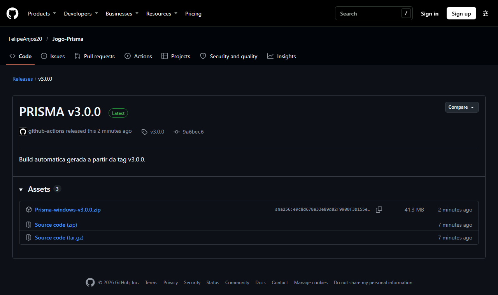
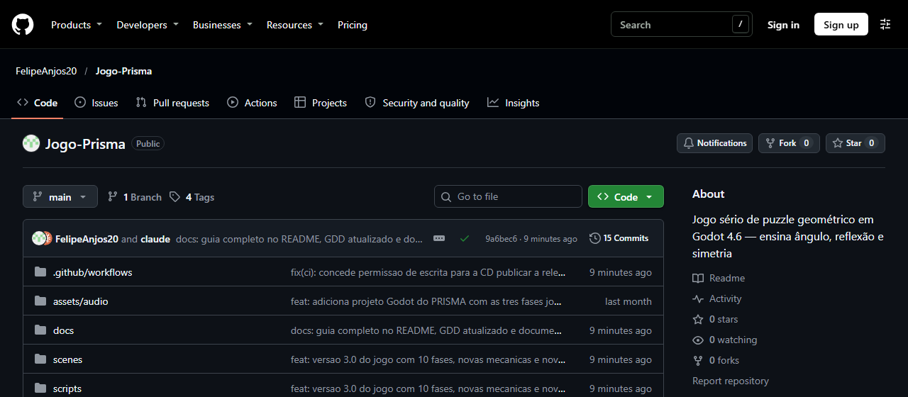

# Como abrir o PRISMA no seu computador

Tutorial passo a passo para abrir e jogar o PRISMA. Leva cerca de **5 minutos** e não exige
conhecimento de programação. Versão para imprimir: [docs/Como_Abrir.pdf](docs/Como_Abrir.pdf).

Escolha uma das duas opções:

| Opção | Para quem | O que precisa |
| --- | --- | --- |
| **[A — Só jogar](#opção-a--só-jogar-windows)** (recomendada) | Quem quer jogar | Windows 10 ou 11 |
| **[B — Abrir o projeto no Godot](#opção-b--abrir-o-projeto-no-godot)** | Quem quer ver o código, as cenas e rodar pelo motor | Windows, Linux ou macOS + Godot 4.6.3 |

---

## Opção A — Só jogar (Windows)

**1. Baixe o jogo.** Abra a página de download:

> **https://github.com/FelipeAnjos20/Jogo-Prisma/releases/latest**

Em **Assets**, clique no arquivo **`Prisma-windows-v…zip`** da versão mais recente (cerca de 41 MB).
Não clique em "Source code", que é só o código. Não é preciso ter conta no GitHub.

**2. Se o navegador disser "Vírus detectado" ou o download sumir:** é um **alarme falso** do Windows
Defender, comum em jogos feitos com Godot que não têm assinatura digital paga. O aviso costuma ter o nome
`Trojan:Script/Wacatac.H!ml`; o final **`!ml`** quer dizer que é só uma suspeita automática, não um
vírus encontrado. Para liberar:

1. Abra **Segurança do Windows** (procure no menu Iniciar) → **Proteção contra vírus e ameaças** →
   **Histórico de proteção**.
2. Clique no item que cita `Prisma-windows-v…zip` e confira que o arquivo é o do PRISMA.
3. Em **Ações**, escolha **Permitir no dispositivo** (o Windows pede confirmação de administrador).
4. Volte à página de download e baixe de novo.

Se preferir não mexer no antivírus, use a **[Opção B](#opção-b--abrir-o-projeto-no-godot)**, que roda o
jogo pelo Godot sem baixar nenhum `.exe`.

**3. Extraia o arquivo.** Na pasta **Downloads**, clique com o **botão direito** em
`Prisma-windows-v…zip` → **Extrair Tudo...** → **Extrair**.

> Não abra o jogo direto de dentro do zip, porque ele não funciona assim. Extraia primeiro.

**4. Abra o jogo.** Na pasta extraída, dê **dois cliques em `Prisma.exe`**. Se o Windows estiver
escondendo as extensões, o arquivo aparece como **Prisma**, do tipo "Aplicativo".

> O arquivo `Prisma.pck` precisa ficar **na mesma pasta** do `Prisma.exe`, porque ele contém o jogo.

**5. Se aparecer "O Windows protegeu o computador":** clique em **Mais informações** e depois em
**Executar assim mesmo**. O aviso aparece porque o jogo não tem uma assinatura digital paga, o que é
comum em projetos acadêmicos e independentes.

**6. Jogue!** No menu, clique em **Jogar**. Veja os [primeiros passos no jogo](#primeiros-passos-no-jogo).

---

## Opção B — Abrir o projeto no Godot

**1. Baixe o Godot 4.6.3.** Abra a página:

> **https://godotengine.org/download/archive/4.6.3-stable/**

Baixe a versão **Standard** para o seu sistema. **Não use a versão .NET.** No Windows, o arquivo se
chama `Godot_v4.6.3-stable_win64.exe.zip`. Extraia o zip. O Godot não tem instalador: o programa é o
próprio arquivo `Godot_v4.6.3-stable_win64.exe`.

**2. Baixe o projeto.** Na página do repositório,
**https://github.com/FelipeAnjos20/Jogo-Prisma**, clique no botão verde **Code** e depois em
**Download ZIP**.

Extraia o zip: botão direito em `Jogo-Prisma-main.zip` → **Extrair Tudo...** → **Extrair**.

> **Atenção: o Windows cria uma pasta dentro da outra.** O resultado fica assim:
> `Downloads\Jogo-Prisma-main\Jogo-Prisma-main\project.godot`. O arquivo **`project.godot`** está na
> pasta **de dentro**. Se quiser deixar mais simples, mova a pasta de dentro para um caminho curto,
> como `C:\Jogo-Prisma-main`, e confira se o `project.godot` aparece logo ao abri-la.

> Quem usa Git pode clonar: `git clone https://github.com/FelipeAnjos20/Jogo-Prisma.git`

**3. Importe o projeto no Godot.**

1. Abra o `Godot_v4.6.3-stable_win64.exe`. Aparece o **Gerenciador de Projetos**.
2. Clique em **Importar**. No editor em inglês, o botão se chama **Import**.
3. Navegue até a pasta **de dentro** (a que tem o `project.godot`) e selecione o arquivo **`project.godot`**.
   Se o Godot disser que a pasta não tem projeto, você está na pasta de fora: entre na de dentro.
4. Clique em **Importar e Editar** (**Import & Edit**).

> **Usando um Godot mais novo (4.7 ou depois)?** Ele avisa que o projeto foi feito numa versão anterior
> e pergunta se quer converter/atualizar. Pode confirmar: o jogo funciona. Mas, se você for **enviar
> mudanças para o GitHub**, use o 4.6.3, porque a conversão altera o `project.godot` e outros arquivos.

**4. Aguarde a primeira importação.** Leva de 5 a 20 segundos e acontece só na primeira vez.
Enquanto isso aparecem barras de progresso ("Importando recursos"); espere terminar antes de rodar.

**5. Rode o jogo.** Aperte **F5**, ou clique no botão **▶** no canto superior direito do editor.
O jogo abre no menu principal.

> **O jogo abriu dentro do editor e o clique não funciona?** Nas versões mais novas do Godot (4.4 em
> diante), o jogo roda dentro da aba **Jogo** do editor. Clique no botão **Entrada** (canto esquerdo da
> barra acima do jogo) para o mouse e o teclado irem para o jogo. Para abrir numa janela separada,
> clique nos **⋮** dessa barra e desmarque a opção de incorporar o jogo.
>
> O projeto foi feito no Godot 4.6, mas também abre em versões 4.x mais novas (testado no 4.7).

---

## Primeiros passos no jogo

1. No menu, clique em **Jogar**.
2. Na primeira vez, o assistente **Echo** pergunta seu nome. A **fase 1 tem um tutorial**: uma seta
   mostra qual espelho girar, e o Echo explica o que fazer.
3. **Objetivo:** levar o raio de luz do emissor até **todos os cristais** da sala ao mesmo tempo.
   Quando todos acendem, a fase está concluída e a próxima é liberada.
4. **Não existe derrota.** Dá para tentar quantas vezes quiser. Quanto menos giros, mais estrelas (até 3 por fase).

**Controles principais**

| Para... | Faça |
| --- | --- |
| Selecionar um espelho | Clique nele (ou teclas `1`–`9`) |
| Girar o espelho (15° por vez) | Arraste a ponta dele, use `Q` / `E` ou a roda do mouse |
| Desfazer o último giro | `Z` |
| Pedir uma dica | `H` (apertando de novo, aparece o ângulo certo de um espelho) |
| Reiniciar a fase | `R` |
| Pausar / voltar ao menu | `Esc` |
| Ir para a próxima fase depois de vencer | `N` ou `Enter` |
| Tela cheia | `F11` |
| Mostrar/esconder os ângulos (incidência e reflexão) | `G` |
| Conversar com o Echo (dica, curiosidade, falar menos) | Clique no Echo da barra de cima ou `T` |

> **Dica:** pare o mouse sobre qualquer peça para saber o que ela faz. O assistente **Echo** também
> comenta o que você faz: avisa quando o raio passou perto, quando a cor está errada e oferece ajuda.
> Ao vencer, clique em **Por que funcionou?** para ver a explicação da sua solução.

A lista completa de controles, regras e elementos do jogo está no [README](README.md#6-como-jogar-iniciar-uma-partida-e-controles)
e no menu **Como jogar** dentro do jogo.

---

## Problemas comuns

| Problema | Solução |
| --- | --- |
| O download falhou com "Vírus detectado" ou o zip sumiu da pasta Downloads | Alarme falso do Windows Defender: veja o [passo 2 da Opção A](#opção-a--só-jogar-windows) ou use a Opção B. |
| O jogo não abre e reclama de um arquivo `.pck` | Extraia o zip inteiro e mantenha `Prisma.exe` e `Prisma.pck` juntos na mesma pasta. |
| O Windows bloqueou o arquivo | Clique em **Mais informações → Executar assim mesmo**. Se não houver essa opção: botão direito em `Prisma.exe` → **Propriedades** → marque **Desbloquear** → **OK**. |
| O Godot não encontra o projeto ou diz que a pasta é inválida | Entre na pasta **de dentro** (`Jogo-Prisma-main\Jogo-Prisma-main`) e selecione o `project.godot`. |
| O Godot diz que o projeto é de outra versão | Use o **Godot 4.6.3** (ou outro 4.6.x), versão **Standard**. Num 4.7 ou mais novo, pode confirmar a conversão só para jogar. |
| O Godot abre, mas dá erro ao rodar (F5) | Espere a importação terminar (barras de progresso). Se continuar, feche o Godot, apague a pasta `.godot` dentro do projeto e abra de novo. |
| Abri pela versão .NET (Mono) e não funciona | Baixe a versão **Standard**. A versão .NET pede programas extras que o projeto não usa. |
| Tela preta ou erro de vídeo | Atualize o driver da placa de vídeo. O jogo precisa de OpenGL 3.3, que quase todo computador tem. |
| Sem som | Confira o volume do Windows e, no jogo, **Opções** (volume) e a tecla `M` (liga e desliga a música). |
| O jogo abriu pausado | Ele pausa sozinho quando a janela perde o foco. Clique em **Continuar** ou aperte `Esc`. |

Mais detalhes técnicos estão no [README](README.md) e no [Manual de reconstrução](docs/Manual_de_Reconstrucao.pdf).
