# PRISMA — O lugar onde a luz quebrou

[](https://github.com/FelipeAnjos20/Jogo-Prisma/actions/workflows/ci.yml)

Jogo sério de puzzle 2D feito em **Godot 4.6**. O jogador gira espelhos e usa divisores, filtros de
cor e prismas para guiar um raio de luz até os cristais de cada sala. A proposta é tornar
tangíveis os conceitos de **ângulo, reflexão, simetria e decomposição da luz**: cada giro tem um
efeito imediato e visível no caminho do feixe.

A cada sala concluída o jogador recupera um dos **10 fragmentos do Prisma de Luz**, guiado pelo
assistente **Echo**.

> ## ▶ Primeira vez? Comece por aqui: **[Como abrir o PRISMA no seu computador](COMO_ABRIR.md)**
> Tutorial passo a passo (5 minutos) para baixar, abrir e jogar, sem precisar de conhecimento técnico.

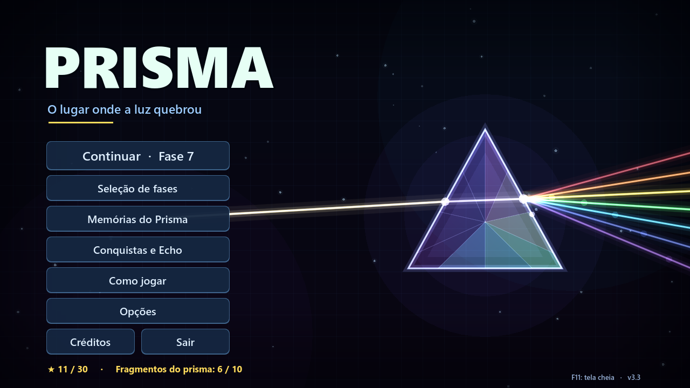

> **Projeto acadêmico** — PAC Extensionista III, Engenharia de Software, Católica de Santa Catarina.
> Equipe: Eduardo Macedo, Felipe dos Anjos, Felipe Schwabe e Vinicius Mesquita.

## Sumário

1. [Jogar agora (executável pronto)](#1-jogar-agora-executável-pronto)
2. [Requisitos](#2-requisitos)
3. [Baixar ou clonar o projeto](#3-baixar-ou-clonar-o-projeto)
4. [Instalar dependências e configurar o ambiente](#4-instalar-dependências-e-configurar-o-ambiente)
5. [Executar o jogo pelo Godot](#5-executar-o-jogo-pelo-godot)
6. [Como jogar: iniciar uma partida e controles](#6-como-jogar-iniciar-uma-partida-e-controles)
7. [Objetivo, regras, vitória e progressão](#7-objetivo-regras-vitória-e-progressão)
8. [Limitações conhecidas e o que ainda não foi implementado](#8-limitações-conhecidas-e-o-que-ainda-não-foi-implementado)
9. [GDD e documentação](#9-gdd-e-documentação)
10. [Estrutura do repositório](#10-estrutura-do-repositório)
11. [Testes, CI e releases](#11-testes-ci-e-releases)
12. [Créditos](#12-créditos)

---

## 1. Jogar agora (executável pronto)

Para só jogar, sem instalar nada:

1. Abra a página de **[Releases](https://github.com/FelipeAnjos20/Jogo-Prisma/releases/latest)** e
   baixe o arquivo `Prisma-windows-vX.Y.Z.zip`.
2. Extraia o zip em uma pasta.
3. Dê dois cliques em **`Prisma.exe`**. O arquivo `Prisma.pck` precisa continuar na mesma pasta.

> Na primeira execução o Windows pode mostrar *"O Windows protegeu o computador"*. O executável
> não tem assinatura digital paga, então clique em **Mais informações → Executar assim mesmo**.

Para abrir o código-fonte e rodar pelo motor, siga os passos 2 a 5.

## 2. Requisitos

| Item | Requisito |
| --- | --- |
| Sistema operacional | **Windows 10 ou 11 (64 bits)** para o executável pronto. O projeto também abre no Linux e no macOS pelo editor do Godot. |
| Placa de vídeo | Compatível com **OpenGL 3.3**, o que inclui vídeo integrado Intel e AMD dos últimos ~10 anos. O jogo usa o renderizador *Compatibility*. |
| Memória e disco | 4 GB de RAM e cerca de 400 MB livres (Godot + projeto + cache). |
| Engine | **Godot Engine 4.6**, versão **Standard** (não a .NET). Testado com **4.6.3**, a mesma versão usada pela CI. |
| Git (opcional) | Qualquer versão recente, para clonar o repositório. |
| Node.js (opcional) | 18+, só para a ferramenta de validação de fases em `tools/level_simulator`. |

Não há plugins, bibliotecas ou pacotes de assets externos. A arte é desenhada por código, os
efeitos sonoros são sintetizados pelo próprio jogo e as músicas já estão em `assets/audio/`.

## 3. Baixar ou clonar o projeto

**Com Git:**

```bash
git clone https://github.com/FelipeAnjos20/Jogo-Prisma.git
cd Jogo-Prisma
```

**Sem Git:** na página do repositório, clique em **Code → Download ZIP** e extraia o arquivo. Prefira
um caminho curto, como `C:\Jogo-Prisma`.

## 4. Instalar dependências e configurar o ambiente

A única dependência é o Godot:

1. Baixe o **Godot 4.6.3 Standard** para o seu sistema em
   <https://godotengine.org/download/archive/4.6.3-stable/>. No Windows, o arquivo é
   `Godot_v4.6.3-stable_win64.exe.zip`.
2. Extraia o zip. O Godot **não tem instalador**: é um único executável.

Não é necessário configurar mais nada. As configurações do projeto já estão no repositório:
cena inicial, resolução 1280×720 com escala automática, tema da interface e *autoloads*
(`GameState`, `Sfx`, `Transition`).

## 5. Executar o jogo pelo Godot

**Pelo editor:**

1. Abra o Godot. Vai aparecer o **Gerenciador de Projetos**.
2. Clique em **Importar**, selecione o arquivo **`project.godot`** na pasta do repositório e confirme
   em **Importar e Editar**.
3. Aguarde a primeira importação (5 a 20 segundos). Ela cria a pasta `.godot/`, que é cache e não vai
   para o Git.
4. Aperte **F5** (ou o botão ▶ no canto superior direito). O jogo abre no menu principal
   (`scenes/menu.tscn`).

**Pela linha de comando** (sem abrir o editor), dentro da pasta do repositório:

```bash
# importa os recursos uma vez (cria a pasta .godot/)
godot --headless --editor --quit-after 60
# executa o jogo
godot --path .
```

> No Windows, troque `godot` pelo caminho do executável, por exemplo
> `C:\Godot\Godot_v4.6.3-stable_win64.exe --path .`

**Para gerar um executável:** no editor, use *Editor → Gerenciar Modelos de Exportação → Baixar e
Instalar* (uma vez) e depois *Projeto → Exportar → Windows Desktop → Exportar Projeto*. A saída
padrão é `build/windows/Prisma.exe`, e essa pasta é ignorada pelo Git.

O manual completo, com checklist de conferência e solução de problemas, está em
[docs/Manual_de_Reconstrucao.pdf](docs/Manual_de_Reconstrucao.pdf).

## 6. Como jogar: iniciar uma partida e controles

### Iniciando uma partida

1. No menu principal, clique em **Jogar** (ou **Continuar**, se já houver progresso). Na primeira vez,
   o Echo se apresenta e pergunta **como você quer ser chamado** (dá para pular). Você também pode
   escolher qualquer fase liberada em **Seleção de fases**.
   Antes da fase começar, a tela **Antes de começar** mostra o objetivo e os controles desenhados como
   teclas (Clique, Q/E, Z, H, R, T, Esc). Dá para marcar **Não mostrar de novo**.
2. A **fase 1 tem um tutorial**: uma seta animada mostra qual espelho girar, e o assistente Echo
   explica a mecânica. Em cada fase nova, Echo apresenta o elemento novo.
3. Em **Como jogar**, no menu, há um resumo dos controles e dos elementos. Em **Opções** ficam o
   volume da música e dos efeitos, a tela cheia e o guia de ângulos.
4. **Parou o mouse sobre uma peça?** Aparece uma caixa explicando o que ela é e o que faz.

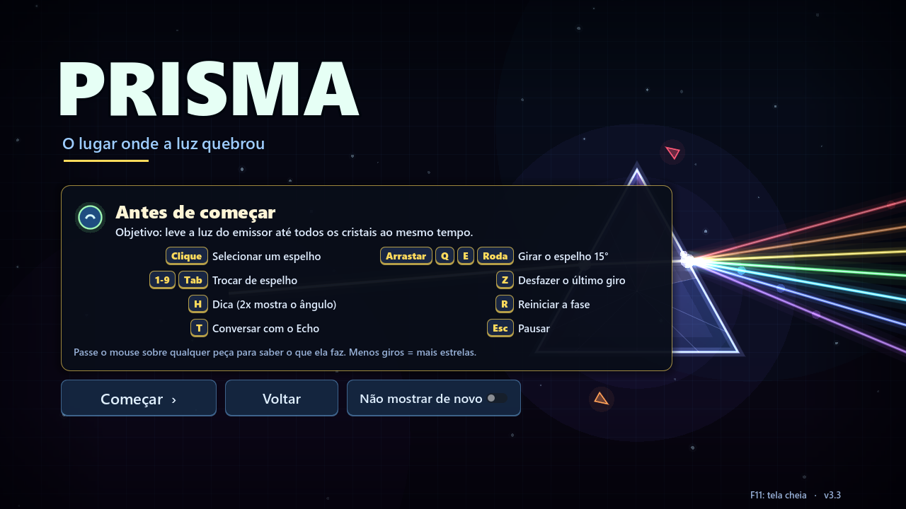

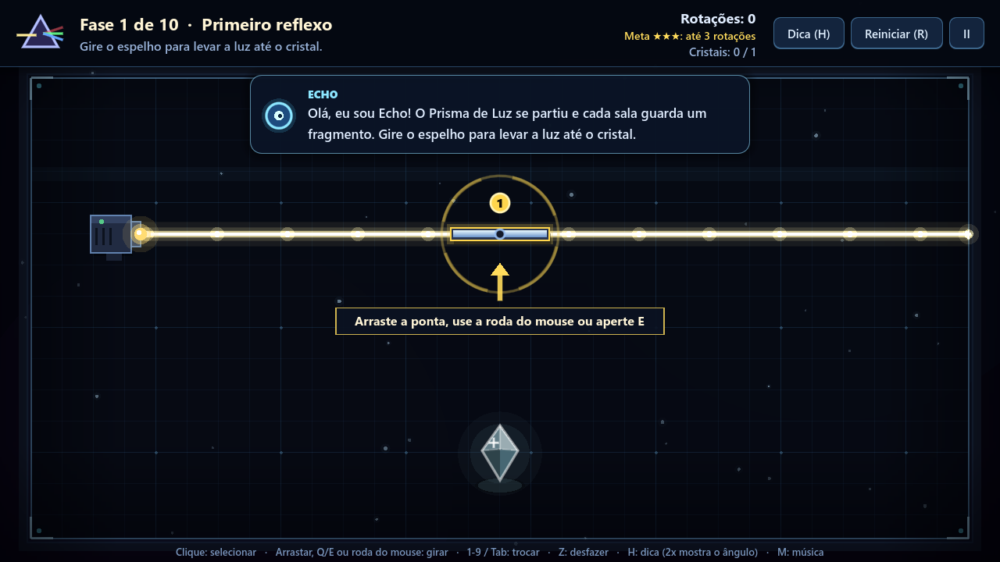

### Controles

| Ação | Teclado e mouse | Controle (Xbox/PS) |
| --- | --- | --- |
| Selecionar um espelho | Clique no espelho, teclas `1`–`9`, `Tab` / `Shift+Tab` | LB / RB |
| Girar o espelho selecionado (15° por passo) | Arrastar a ponta do espelho, `Q` / `E` (também `A`/`D` e ←/→), roda do mouse, clicar de novo no espelho (horário), clique direito (anti-horário) | Direcional ◀ ▶, A |
| Desfazer o último giro | `Z` | B |
| Pedir dica ao Echo | `H` (a 2ª vez mostra o ângulo certo de um espelho) | Y |
| Reiniciar a fase | `R` | X |
| Pausar (continuar, reiniciar, música, fases, menu) | `Esc` ou `P` | Start |
| Ir para a próxima fase (após vencer) | `N`, `Enter` ou `Espaço` | A |
| Mostrar/esconder o guia de ângulos | `G` | — |
| Saber o que é uma peça | Parar o mouse sobre ela | — |
| Conversar com o Echo (dica, curiosidade, falar menos/mais) | Clicar no Echo da barra superior ou `T`; responder com clique ou `1`–`4` | — |
| Ligar/desligar a música | `M` | Select |
| Tela cheia | `F11` ou `Alt+Enter` | — |

Os menus também podem ser usados com as setas + `Enter` ou com o controle.

### O jogo conversa com você

O PRISMA reage a cada ação do jogador:

- **Echo comenta o que você faz, na hora.** Ele comemora cada cristal aceso ("Acertou um! Falta só 1."),
  avisa quando um cristal apaga e quando o raio **passou perto** ("Quase! O raio passou a 42 px do cristal").
  Também dá um retorno de **quente ou frio** ("Está esquentando!" / "Esfriou...") e explica quando a luz chegou
  com a **cor errada**. Se você girar muito sem progresso ou repetir uma posição já testada, ele oferece ajuda.
  O texto aparece letra por letra, com som, e Echo muda de expressão (feliz, pensativo, surpreso).
- **Guia de ângulos (tecla `G`):** no espelho selecionado aparecem a inclinação (θ) e, no ponto onde a
  luz bate, a **normal** e os ângulos de **incidência (i)** e de **reflexão (r)**. Assim dá para ver na
  prática que **i = r** sempre.
- **Caixa de informação:** parar o mouse sobre qualquer peça explica o que ela é (espelho, divisor,
  filtro, prisma, cristal, bloco, emissor), com a inclinação atual e a cor exigida.
- **"Por que funcionou?":** ao vencer, Echo comenta o seu desempenho, e esse botão mostra a explicação da
  **sua** solução: cada reflexão, com incidência = reflexão e quanto o raio virou, mais o papel do
  divisor, do filtro e do prisma.

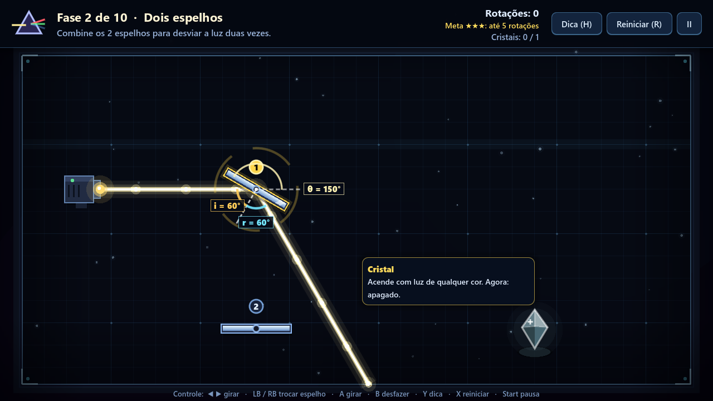

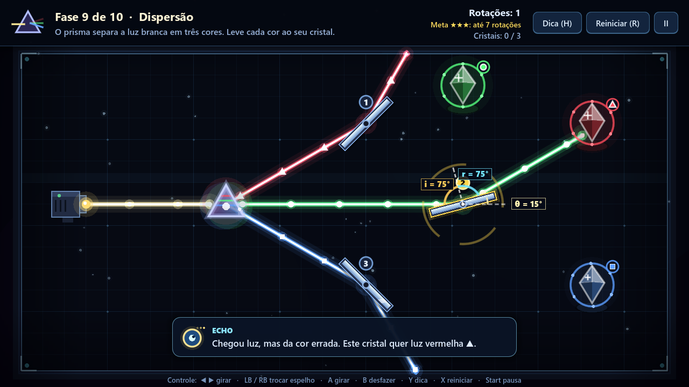

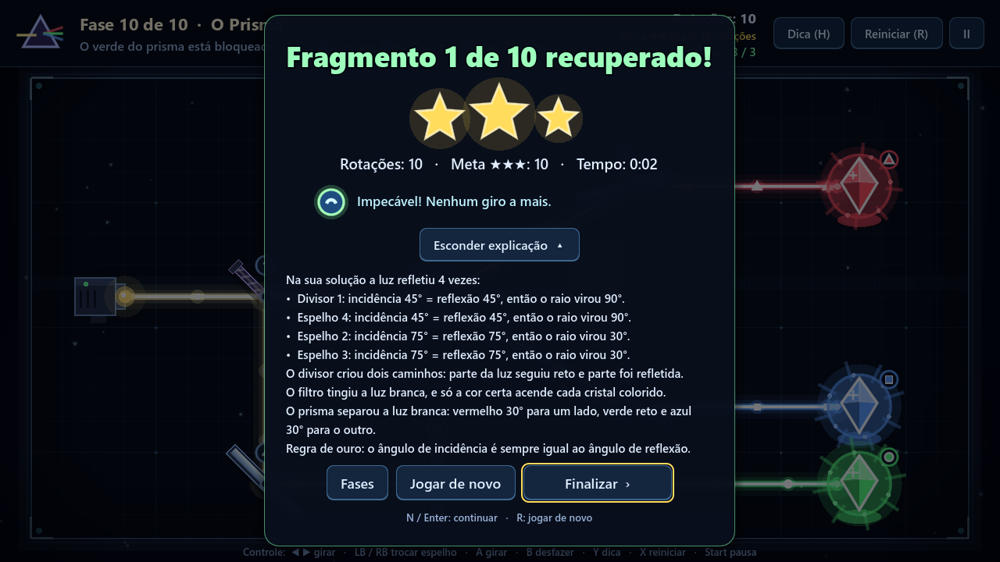

### Mais interativo (versão 3.2)

- **A luz vira música.** Cada cristal aceso toca a próxima nota de um acorde, então resolver uma fase
  com vários cristais "monta" uma música. Cada posição do espelho tem um tom próprio, e cada fase
  termina com a **sua** melodia de vitória.
- **Cristal "quase lá".** Quando o raio passa perto de um cristal apagado, ele **treme e brilha fraquinho**.
  Quanto mais perto, mais forte: é uma pista visual que não entrega a resposta.
- **Peças com peso.** O espelho balança ao girar, e na vitória saem faíscas de todo o caminho da luz.
- **Echo é um personagem.** Ele fica na barra superior, **olha para o mouse**, muda de expressão, cochila
  se você ficar muito tempo parado (e acorda assustado quando você volta). **Clique nele** (ou `T`) para
  pedir uma dica, ouvir uma curiosidade sobre a luz ou pedir que ele fale menos.
- **O jogador responde ao Echo.** Ele pergunta seu nome no início e passa a te chamar por ele. Na fase 2,
  pergunta se você quer pistas quando travar: **"Sim, me ajuda!"** ou **"Deixa comigo!"**. No modo
  "Deixa comigo", ele só comemora e avisa o que acontece. A escolha pode ser mudada em *Opções*.
- **Os fragmentos contam uma história.** Cada fase concluída pela primeira vez devolve uma **memória** do
  Prisma: o Farol de Aurora, a tempestade que o quebrou e o segredo de Echo. Todas ficam guardadas em
  **Memórias do Prisma**, no menu, e a última libera o final.

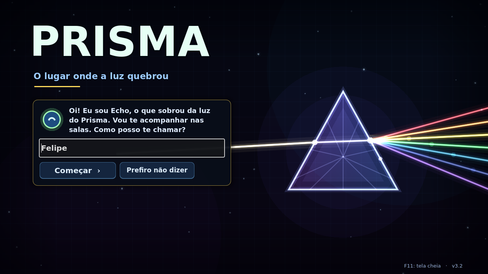

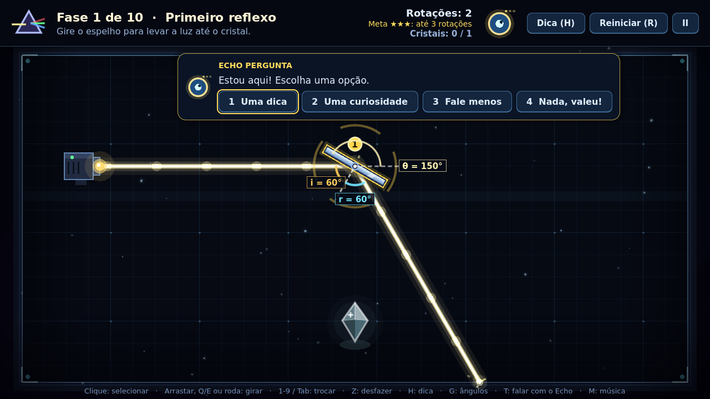

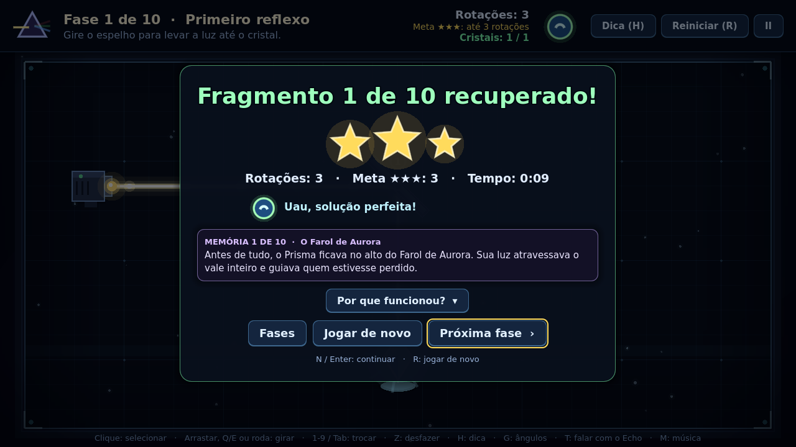

### Mais interativo e mais bonito (versão 3.3)

As regras e as soluções das fases continuam as mesmas: a versão 3.3 mexe só no que o jogador vê e sente.

- **Prévia da luz.** Passe o mouse sobre um espelho: um **tracejado** mostra para onde a luz iria no
  próximo giro. Dá para experimentar sem medo antes de clicar (liga e desliga com `G`).
- **O Echo voa até o espelho.** Ao pedir uma dica, Echo sai da barra superior, voa até o espelho que
  precisa girar, fica ao lado dele e depois volta para o lugar.
- **Vitória de cinema.** Quando o último cristal acende, a cena fica em câmera lenta por um instante,
  a câmera se aproxima do cristal e um **fragmento brilhante voa** até o prisma no canto da tela.
- **Conquistas.** São 10 (por exemplo "Por conta própria", "Na medida", "Cientista" e "Céu estrelado").
  Cada uma aparece com um troféu na hora e fica guardada em **Conquistas e Echo**, no menu.
- **As estrelas viram presentes para o Echo.** Juntando estrelas, você libera **cores** (menta, rosa,
  violeta, dourado, arco-íris) e **acessórios** (laço, chapéu de mago, coroa) para o Echo.
- **O Farol de Aurora.** A seleção de fases virou o farol da história: cada fase é um andar, e as janelas
  **acendem** conforme você conclui. A lanterna no topo brilha mais a cada fragmento recuperado.
- **A sala toca música.** Clique num espaço vazio da sala: sai uma onda de luz e uma nota (grave à
  esquerda, aguda à direita).
- **Nada na frente do puzzle.** O Echo fala na barra de cima, ao lado dele (como uma legenda), os atalhos aparecem aos poucos e os
  cristais da barra superior viram gemas que acendem. Os botões crescem e brilham ao passar o mouse.
- **Cada sala com a sua cor.** O raio **nasce** do emissor ao entrar na fase, e cada grupo de salas tem o
  seu tom: azul frio (1–3), violeta (4–5), âmbar (6–7), verde-azulado (8–9) e dourado (10). A poeira do
  fundo brilha na cor da luz quando o raio passa perto dela.
- **Transição em íris de luz** entre as fases, menu que reage ao mouse (com os fragmentos recuperados
  girando em volta do prisma) e **ícone e tela de abertura próprios**.
- **Reduzir efeitos.** Em *Opções* dá para desligar tremor, flash, câmera lenta, zoom e animações fortes
  (a íris vira um *fade* suave e o raio aparece pronto).
- **Versão 3.4:** cada sala tem o seu clima (poeira, brilhos lilases, faíscas, vaga-lumes e pó dourado);
  a vitória aparece num cartão na lateral, deixando a sala iluminada à mostra; e a barra de cima ganhou
  ícones (lâmpada, reiniciar, pausa) e uma barrinha de rotações que muda de cor ao passar da meta.

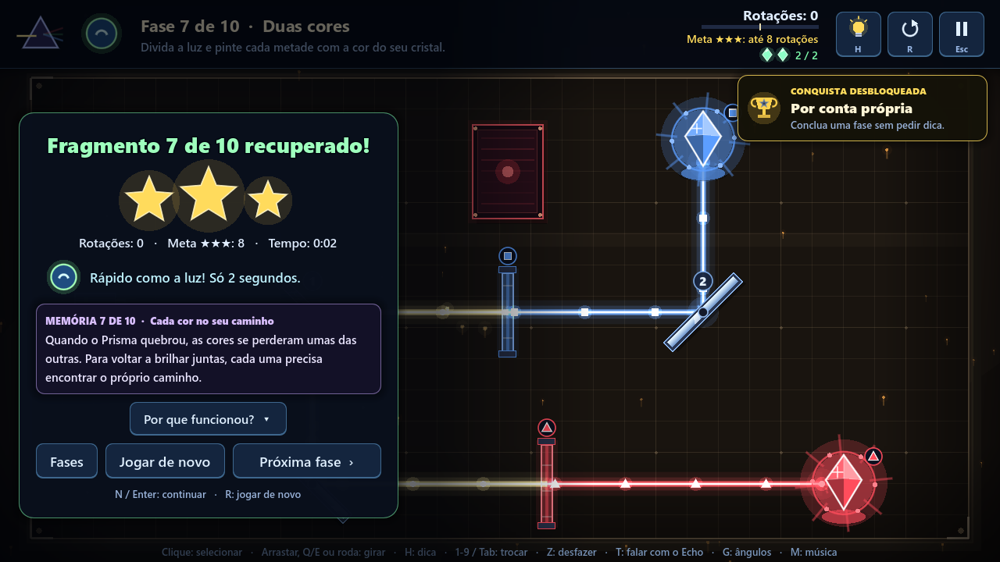

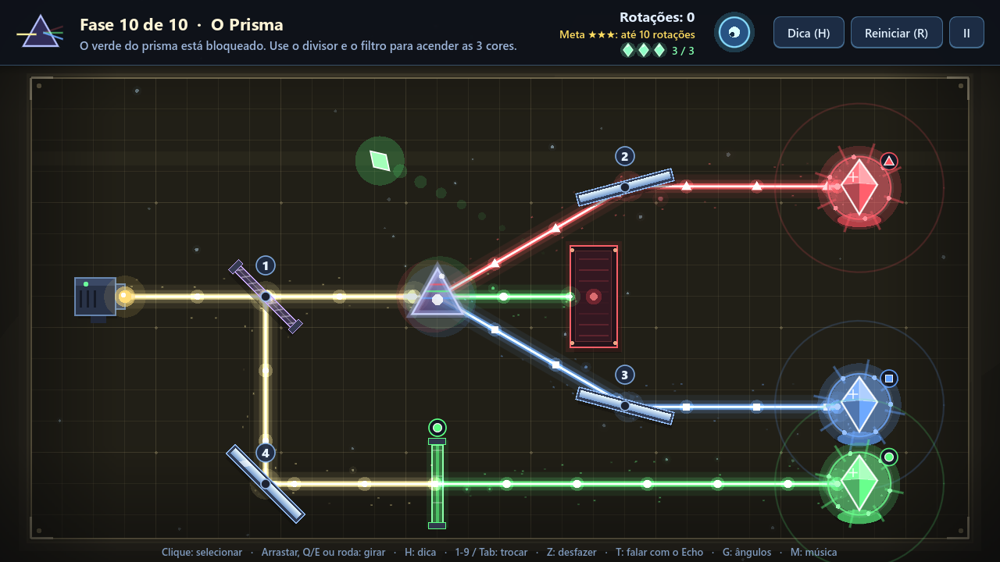

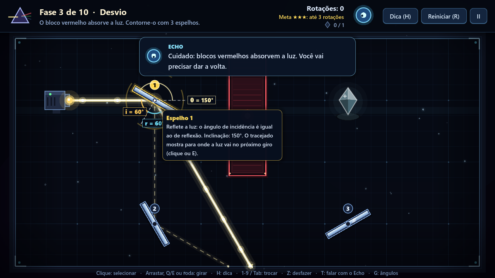

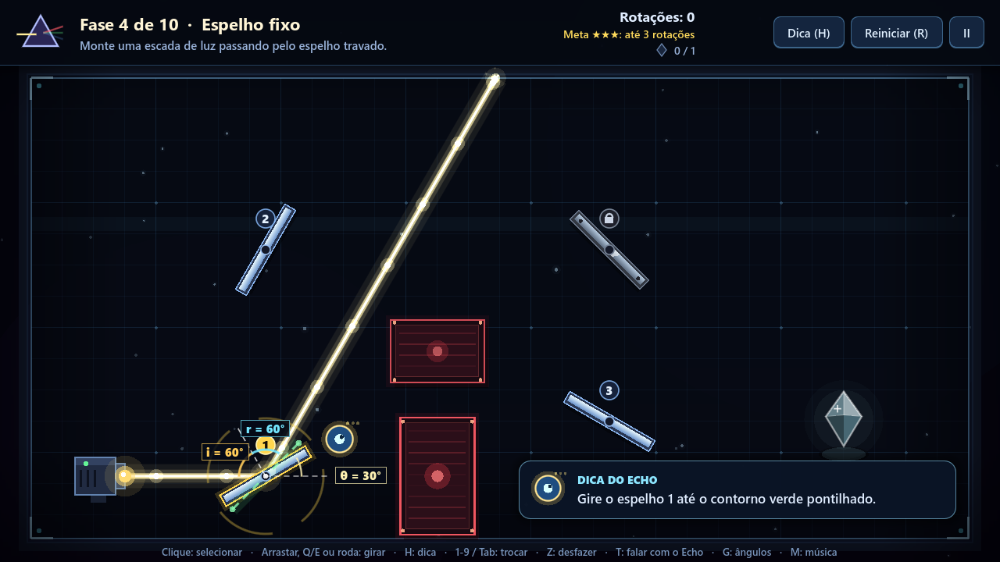

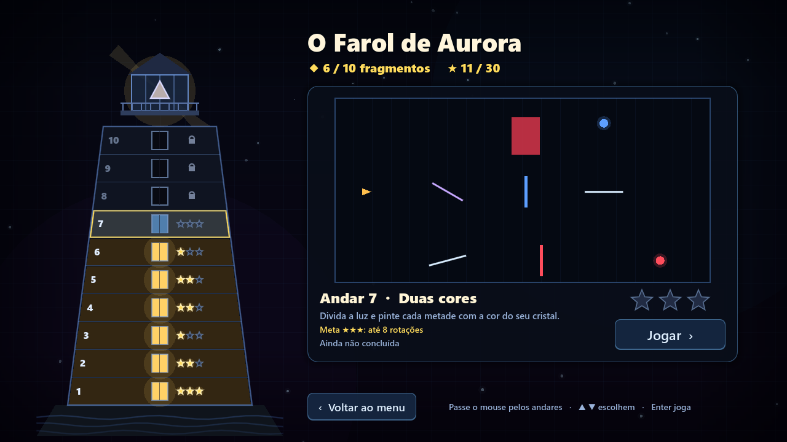

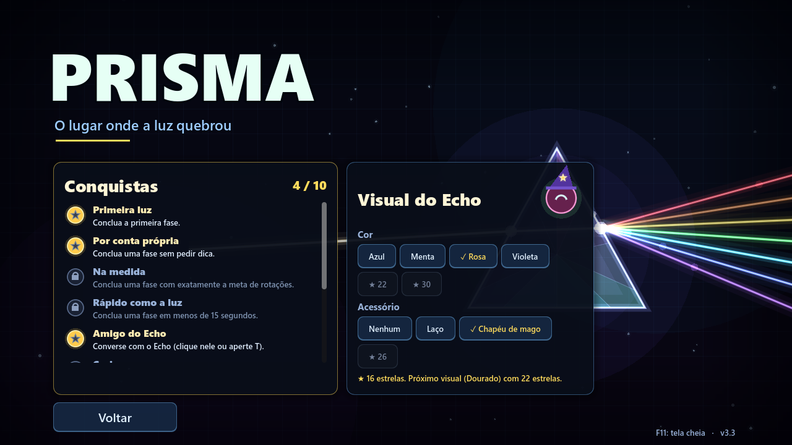

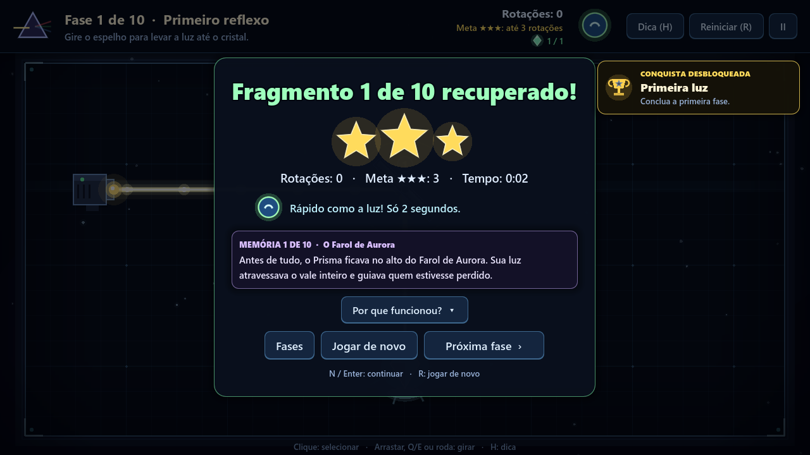

## 7. Objetivo, regras, vitória e progressão

### Objetivo

Levar a luz do **emissor** até **todos os cristais da sala ao mesmo tempo**.

### Elementos e regras

| Elemento | Regra |
| --- | --- |
| **Emissor** | Solta um raio de luz branca em direção fixa. |
| **Espelho** | Reflete a luz (ângulo de incidência = ângulo de reflexão) pelos dois lados. Gira em passos de 15°. |
| **Espelho com cadeado** | Reflete, mas não gira. |
| **Divisor (vidro roxo)** | Parte da luz atravessa reta e parte é refletida, gerando dois raios. |
| **Filtro de cor** | A luz branca sai com a cor do filtro. Luz de **outra cor é bloqueada**. |
| **Prisma** | A luz branca sai dividida em **vermelho** (30° para um lado), **verde** (reto) e **azul** (30° para o outro). Luz colorida atravessa reta. |
| **Bloco vermelho** | Absorve qualquer raio. As paredes da sala também bloqueiam. |
| **Cristal** | Acende ao receber luz. Cristal com **anel colorido** só acende com aquela cor. |

Para quem tem daltonismo, cada cor também tem uma forma: **▲ vermelho, ● verde, ■ azul**. Ela aparece
nos cristais, nos filtros e nos pulsos que correm pelo feixe.

### Condição de vitória

A fase é vencida quando **todos os cristais estão acesos ao mesmo tempo** (o contador "Cristais" no
topo mostra quantos faltam). Aparece o painel de vitória, com o fragmento recuperado, as estrelas,
as rotações, a meta e o tempo.

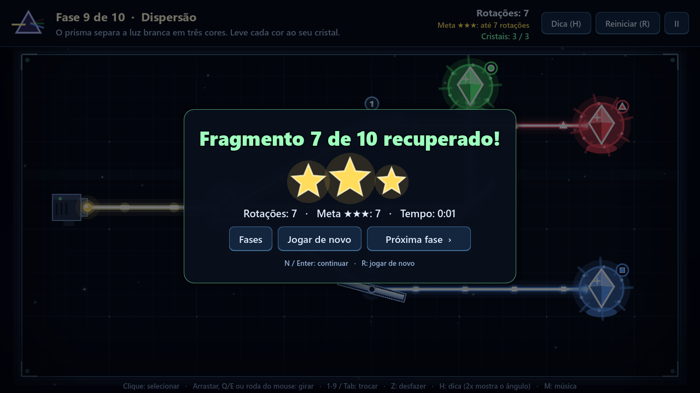

### Derrota

**Não existe derrota.** É um puzzle sem limite de tempo nem de tentativas: dá para girar à vontade,
desfazer (`Z`) e reiniciar (`R`). O desafio está em resolver com **poucas rotações**.

### Progressão

- **10 fases** em sequência: terminar uma fase libera a próxima.
- **Estrelas por fase** (30 no total): ★★★ se o número de rotações for menor ou igual à **meta**
  da fase (o mínimo possível); ★★ até o dobro da meta; ★ ao concluir.
- **Fragmentos:** cada fase concluída recupera um fragmento, que acende no prisma do menu. Ao
  terminar a fase 10, o Prisma de Luz é restaurado e aparece a tela final.
- **Recordes:** o melhor número de rotações de cada fase aparece na seleção de fases (o Farol de Aurora).
- **Conquistas e visual do Echo:** 10 conquistas e, com as estrelas, novas cores e acessórios para o Echo
  (*Conquistas e Echo*, no menu).
- **Dicas:** `H` mostra uma pista em texto; apertando de novo, um **contorno verde** indica o
  ângulo certo de um espelho. Após 45 segundos parado, Echo lembra que a dica existe.
- O progresso e as configurações são **salvos automaticamente**, em
  `%APPDATA%\Godot\app_userdata\PRISMA\prisma_save.cfg` no Windows. Para recomeçar, use
  *Opções → Apagar progresso*.

| # | Fase | O que ensina | Meta ★★★ |
| --- | --- | --- | --- |
| 1 | Primeiro reflexo | Espelho a 45° transforma raio horizontal em vertical | 3 |
| 2 | Dois espelhos | Encadear reflexões | 5 |
| 3 | Desvio | Bloqueios absorvem a luz | 3 |
| 4 | Espelho fixo | Usar um espelho que não gira | 3 |
| 5 | Divisor de luz | Um raio vira dois; dois cristais | 6 |
| 6 | Filtro vermelho | Cristal que exige cor | 7 |
| 7 | Duas cores | Filtro bloqueia cor errada | 8 |
| 8 | Três cristais | Dividir, colorir e dividir de novo | 11 |
| 9 | Dispersão | O prisma separa a luz em três cores | 7 |
| 10 | O Prisma | Desafio final com prisma, divisor e filtro | 10 |

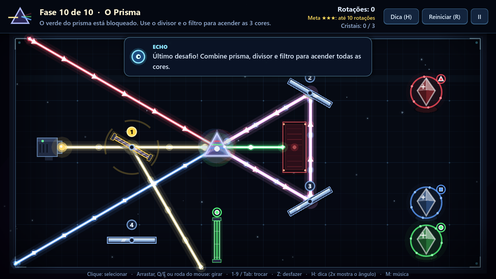

## 8. Limitações conhecidas e o que ainda não foi implementado

**Limitações da versão atual**

- O executável pronto é só para **Windows**. Em Linux e macOS o projeto roda pelo editor do Godot, mas
  não foi testado nesses sistemas nem há build exportada para eles.
- O executável **não tem assinatura digital**: o Windows SmartScreen mostra um aviso na primeira
  execução, e o Windows Defender pode bloquear o download por engano (`Wacatac.H!ml`, alarme falso).
  O [COMO_ABRIR.md](COMO_ABRIR.md) explica como liberar, ou use a opção pelo Godot.
- O **Echo** reage a situações previstas (cristal aceso ou apagado, raio passando perto, quente ou frio,
  cor errada, muitos giros sem progresso, posição repetida). A conversa com ele é por **botões de
  resposta**: ele não entende texto livre nem responde a perguntas digitadas.
- As **memórias** da história são só texto. A tela já aceita uma ilustração por memória
  (`assets/story/fragmento_01.png` a `fragmento_10.png`), mas as imagens ainda não foram feitas.
- O **controle** usa só botões e direcional; o analógico não é usado.
- Não há opções de **tamanho de texto**, **alto contraste** nem **remapeamento de teclas**.
- O jogo está disponível só em **português**.
- A autoria e a licença das **músicas** ainda precisam ser documentadas (ver
  [docs/creditos.md](docs/creditos.md)).

**Planejado para as próximas entregas (N2)**

- Testes de jogabilidade com pessoas de fora da equipe e métricas por fase (tempo, rotações, dicas).
- Mais fases (meta: 15) e uma mecânica nova (ex.: espelho em trilho ou emissor girável).
- Mais situações e falas para o Echo (por exemplo, explicações diferentes por fase) e um "modo professor"
  que mostra os ângulos da solução esperada.
- Versão Web para testes online.
- Acessibilidade ampliada e versão em inglês.

## 9. GDD e documentação

| Documento | Onde consultar |
| --- | --- |
| **Tutorial: como abrir o jogo no seu computador** | **[COMO_ABRIR.md](COMO_ABRIR.md)** |
| **GDD (Game Design Document) atualizado** | **[docs/GDD.md](docs/GDD.md)** (lê direto no GitHub) e [docs/GDD_PRISMA.pdf](docs/GDD_PRISMA.pdf) |
| Manual de reconstrução do ambiente (escrito para o pacote da entrega N1; neste repositório o projeto Godot fica na raiz) | [docs/Manual_de_Reconstrucao.pdf](docs/Manual_de_Reconstrucao.pdf) |
| Vídeo de gameplay (2min41s) | [docs/video/PRISMA_Gameplay_N1.mp4](docs/video/PRISMA_Gameplay_N1.mp4) |
| Contexto e escopo do projeto | [docs/contexto.md](docs/contexto.md) |
| Decisões de arquitetura (ADRs) | [docs/adr/](docs/adr/) |
| Histórico de versões | [CHANGELOG.md](CHANGELOG.md) |
| README do protótipo original (PAC III) | [docs/Prototipo_PAC_III_README.md](docs/Prototipo_PAC_III_README.md) |

## 10. Estrutura do repositório

```
Jogo-Prisma/
├── project.godot              # configuração do projeto (cena inicial, janela, autoloads, tema)
├── export_presets.cfg         # preset "Windows Desktop" (saída em build/windows/)
├── scenes/                    # menu, seleção de fases, fase jogável e tela final
├── scripts/
│   ├── geometria.gd           # regras puras: rotação de 15°, reflexão, interseções, estrelas
│   ├── feixe.gd               # cálculo puro do caminho da luz (usado pelo jogo e pelos testes)
│   ├── levels.gd              # dados das 10 fases (gerado e validado pelo simulador)
│   ├── main.gd / game_hud.gd  # controle da fase e interface
│   ├── game_state.gd          # autoload: progresso, estrelas, salvamento, configurações
│   ├── sfx.gd / transition.gd # autoloads: música + efeitos sintetizados; transições
│   └── ...                    # espelho, cristal, prisma, filtro, bloqueio, emissor, menus, arte
├── ui/prisma_theme.tres       # tema visual de botões e painéis
├── assets/audio/              # músicas do menu e das fases
├── tests/run_tests.gd         # testes automatizados (165 verificações, incluindo as 10 fases)
├── tools/level_simulator/     # simulador de fases em Node.js (ignorado pelo Godot)
├── docs/                      # GDD, manual, vídeo, contexto, ADRs, créditos, imagens
├── .github/workflows/         # CI (testes) e CD (build + release por tag)
├── COMO_ABRIR.md              # tutorial passo a passo para abrir e jogar
└── CHANGELOG.md
```

## 11. Testes, CI e releases

**Testes automatizados** (`tests/run_tests.gd`):

- regras geométricas: passo de rotação, orientação do espelho, reflexão, interseções, estrelas,
  ângulo de incidência e inclinação do espelho;
- **lei da reflexão:** na solução da fase 1, o ângulo de incidência é igual ao de reflexão (45° = 45°);
- regras da luz: filtro bloqueando cor errada e prisma dividindo a luz;
- **as 10 fases**: cada uma é montada a partir dos dados e traçada com o mesmo código do jogo. O teste
  confere que a fase **não começa resolvida**, que **a solução acende todos os cristais** e que a
  **meta de estrelas** é o mínimo de rotações;
- interatividade: notas e melodias, memórias da história, nome do jogador, modo "Deixa comigo",
  conquistas, visual do Echo liberado por estrelas, atalhos por fase e nota da sala.

```bash
godot --headless --editor --quit-after 60   # importa (uma vez)
godot --headless --script res://tests/run_tests.gd
```

- **CI** (`.github/workflows/ci.yml`): roda os testes a cada push ou pull request na `main`.
- **CD** (`.github/workflows/cd.yml`): ao criar uma tag `vMAJOR.MINOR.PATCH`, exporta a build Windows
  (no Linux), grava o ícone e a versão no `Prisma.exe` com o [rcedit](https://github.com/electron/rcedit)
  (num runner Windows) e publica em [Releases](https://github.com/FelipeAnjos20/Jogo-Prisma/releases).

O fluxo de trabalho é *trunk-based development* com Conventional Commits (ver
[ADR 004](docs/adr/004-trunk-based-development.md)).

## 12. Créditos

Veja [docs/creditos.md](docs/creditos.md).
