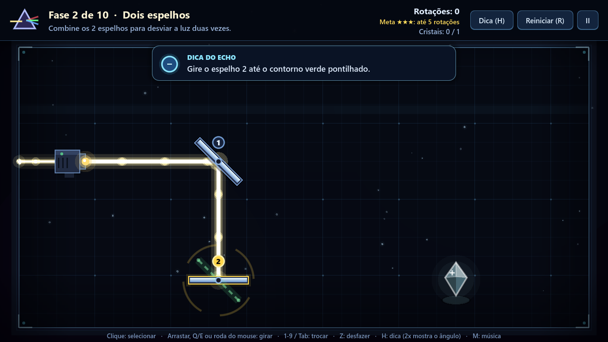
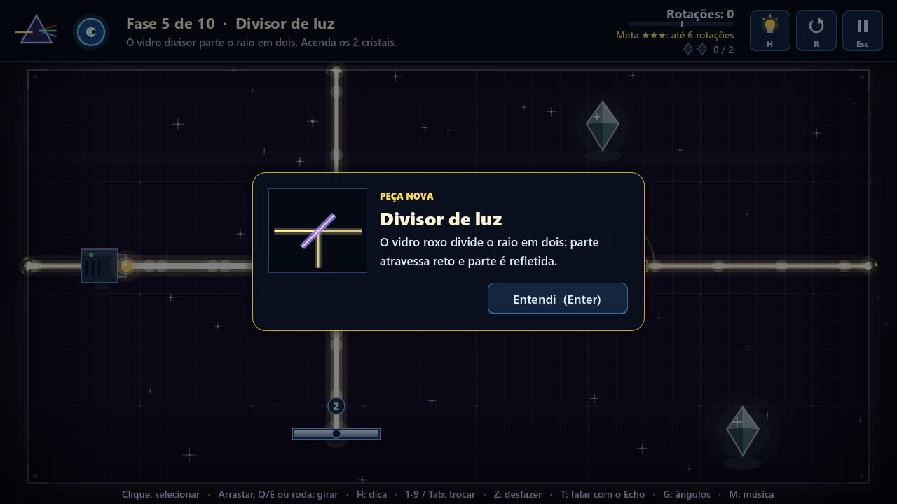

# GDD — PRISMA: O lugar onde a luz quebrou

**Game Design Document** · versão do jogo **3.6.0** · versão em PDF: [GDD_PRISMA.pdf](GDD_PRISMA.pdf)

Equipe: Eduardo Macedo, Felipe dos Anjos, Felipe Schwabe, Vinicius Mesquita
PAC Extensionista III · Engenharia de Software · Católica de Santa Catarina · Prof. Diego Sauter Possamai

## Sumário

1. [Visão geral](#1-visão-geral)
2. [Conceito e pilares de design](#2-conceito-e-pilares-de-design)
3. [Narrativa](#3-narrativa)
4. [Core loop](#4-core-loop)
5. [Mecânicas e regras da luz](#5-mecânicas-e-regras-da-luz)
6. [Controles](#6-controles)
7. [Progressão e recompensas](#7-progressão-e-recompensas)
8. [Level design](#8-level-design)
9. [Sistema de dicas (Echo)](#9-sistema-de-dicas-echo)
10. [Interface e telas](#10-interface-e-telas)
11. [Direção de arte](#11-direção-de-arte)
12. [Áudio](#12-áudio)
13. [Acessibilidade](#13-acessibilidade)
14. [Arquitetura técnica](#14-arquitetura-técnica)
15. [Escopo futuro](#15-escopo-futuro)

---

## 1. Visão geral

| | |
| --- | --- |
| **Título** | PRISMA — O lugar onde a luz quebrou |
| **Gênero** | Puzzle 2D de lógica espacial e óptica (jogo sério) |
| **Plataforma** | PC (Windows). O motor permite exportar para Linux, macOS e Web. |
| **Motor** | Godot Engine 4.6 (GDScript), renderizador *Compatibility* (OpenGL 3.3) |
| **Público-alvo** | A partir de 10 anos; estudantes do ensino fundamental e médio e jogadores de puzzles curtos |
| **Classificação** | Livre |
| **Duração** | 20 a 40 minutos para as 10 fases; mais tempo para conseguir as 30 estrelas |
| **Modo** | Um jogador, sem limite de tempo, com progresso salvo automaticamente |

## 2. Conceito e pilares de design

**High concept:** guie um raio de luz por espelhos, divisores, filtros e prismas para reacender os
cristais de cada sala e restaurar o Prisma de Luz, um fragmento por vez.

| Pilar | O que significa no jogo |
| --- | --- |
| **Clareza** | Todo giro tem retorno imediato: o feixe é recalculado a cada quadro, os pontos de reflexão soltam faíscas e o cristal acende com som e partículas. |
| **Uma ideia por vez** | Cada fase apresenta um único elemento novo, e a seguinte o combina com o que já foi aprendido. |
| **Planejamento** | As estrelas recompensam soluções com poucas rotações, o que incentiva observar antes de girar. |
| **Acessível para todos** | Tutorial visual, dicas em dois níveis, cores com forma, teclado, mouse e controle. |

## 3. Narrativa

O **Prisma de Luz** ficava no alto do **Farol de Aurora** e guiava quem estivesse perdido no vale.
Numa noite de tempestade, um raio atingiu o farol e o Prisma se partiu em dez fragmentos, que caíram
nas salas escuras do subsolo. O jogador é guiado por **Echo**, uma faísca que continuou acesa no meio
das ruínas e aprendeu a falar.

Cada sala concluída pela primeira vez devolve uma **memória** (`scripts/historia.gd`), mostrada no painel
de vitória e guardada em **Memórias do Prisma**, no menu:

| # | Memória | O que revela |
| --- | --- | --- |
| 1 | O Farol de Aurora | Onde o Prisma ficava e para que servia |
| 2 | A noite sem estrelas | A tempestade que o quebrou |
| 3 | As salas escuras | De onde vêm os blocos que absorvem a luz |
| 4 | Os guardiões travados | Por que alguns espelhos não giram |
| 5 | O vidro que divide | A origem do divisor |
| 6 | As cores adormecidas | Por que os filtros tingem a luz |
| 7 | Cada cor no seu caminho | Por que cada cor precisa de uma rota |
| 8 | Uma voz no escuro | Quem é Echo |
| 9 | O segredo de Echo | Echo é o último brilho do próprio Prisma |
| 10 | O Prisma inteiro | O farol acende de novo |

Cada memória explica, dentro da história, a mecânica que o jogador acabou de usar. O fragmento também
acende no prisma do menu. Ao final da fase 10, a tela final mostra o agradecimento de Echo, com o nome
do jogador. A narrativa é curta e não interrompe os puzzles.

## 4. Core loop

```
Observar a sala → Selecionar um espelho → Girar (15°) → Ver o novo caminho da luz
       ↑                                                        │
       │                                                        ▼
Próxima fase ← Fragmento + estrelas ← Todos os cristais acesos? ┘ (não: continuar ajustando)
```

Uma rodada dura de 15 segundos a 3 minutos. O *desfazer* (`Z`) e o *reiniciar* (`R`) tiram o medo
de errar e incentivam a experimentação.

## 5. Mecânicas e regras da luz

| Elemento | Comportamento |
| --- | --- |
| **Emissor** | Origem do raio de luz branca, com direção fixa em cada fase. |
| **Espelho** | Reflete a luz (incidência = reflexão), pelos dois lados. Gira em passos de 15°. |
| **Espelho travado** | Reflete, mas não gira (cadeado). Ao tentar girá-lo, ele treme e toca um som grave. |
| **Divisor (roxo)** | Parte da luz atravessa reta e parte é refletida. Pode ser fixo ou girável. |
| **Filtro de cor** | A luz branca sai com a cor do filtro; luz da mesma cor passa; luz de outra cor é bloqueada. |
| **Prisma** | A luz branca sai em três raios: vermelho (−30°), verde (reto) e azul (+30°) em relação à entrada. Luz colorida atravessa reta. |
| **Bloco absorvedor** | Interrompe qualquer raio. |
| **Cristal** | Acende enquanto recebe luz. Com anel colorido, só aceita a cor indicada (▲ vermelho, ● verde, ■ azul). |
| **Paredes da sala** | Interrompem o raio, que nunca sai da área jogável. |

**Regras de vitória**

- A fase é vencida quando **todos os cristais estão acesos ao mesmo tempo** e os espelhos terminaram de girar.
- O estado dos cristais só muda com os espelhos parados, o que evita vitórias acidentais no meio de um giro.
- Como os espelhos giram em múltiplos de 15°, os raios seguem direções múltiplas de 30°, e as soluções ficam "limpas" e previsíveis.
- **Não há derrota**: sem limite de tempo ou de tentativas. O desafio é resolver com poucas rotações.

## 6. Controles

| Ação | Teclado e mouse | Controle |
| --- | --- | --- |
| Selecionar espelho | Clique, `1`–`9`, `Tab` / `Shift+Tab` | LB / RB |
| Girar | Arrastar a ponta, `Q`/`E`, `A`/`D`, ←/→, roda do mouse, clicar de novo (horário), clique direito (anti-horário) | Direcional ◀ ▶, A |
| Desfazer | `Z` | B |
| Dica | `H` (duas vezes mostra o ângulo) | Y |
| Reiniciar | `R` | X |
| Pausa | `Esc` ou `P` | Start |
| Próxima fase | `N`, `Enter`, `Espaço` | A |
| Guia de ângulos | `G` | — |
| Saber o que é uma peça | Parar o mouse sobre ela | — |
| Música | `M` | Select |
| Tela cheia | `F11` ou `Alt+Enter` | — |

Os menus podem ser navegados pelo mouse, pelas setas do teclado ou pelo controle. O destaque de foco
só aparece quando o jogador usa teclado ou controle.

## 7. Progressão e recompensas

- **Desbloqueio linear:** terminar uma fase libera a próxima; dá para rejogar qualquer fase liberada.
- **Estrelas (até 3 por fase, 30 no total):** ★★★ se as rotações ≤ meta; ★★ até o dobro; ★ ao concluir.
- **Meta:** o menor número de rotações possível em cada fase, calculado pelo simulador e conferido pelos testes.
- **Fragmentos:** a primeira conclusão de cada fase recupera um fragmento ("Fragmento 3 de 10 recuperado!"), que acende no prisma do menu.
- **Recordes:** o melhor número de rotações aparece na seleção de fases; bater o recorde mostra "Novo recorde pessoal!".
- **Tempo:** mostrado no painel de vitória (informativo, não pontua).
- **Conquistas (versão 3.3):** 10 conquistas (`scripts/conquistas.gd`): Primeira luz, Por conta própria
  (sem dica), Na medida (exatamente a meta), Rápido como a luz (menos de 15 s), Amigo do Echo, Curioso
  (3 curiosidades), Cientista (abrir "Por que funcionou?"), Meio prisma, Prisma restaurado e Céu estrelado
  (30 estrelas). Aparecem com um troféu na hora e ficam na tela "Conquistas e Echo".
- **As estrelas viram recompensas:** cores do Echo (menta 5, rosa 10, violeta 15, dourado 22,
  arco-íris 30) e acessórios (laço 8, chapéu de mago 16, coroa 26). O jogador escolhe no menu.

## 8. Level design

Cada fase apresenta um conceito novo, e a seguinte o combina com os anteriores. Todas são validadas
automaticamente: existe solução, a fase não começa resolvida e a meta é o mínimo de rotações
(`tools/level_simulator` e `tests/run_tests.gd`).

| # | Fase | O que ensina / novidade | Elementos | Meta |
| --- | --- | --- | --- | --- |
| 1 | Primeiro reflexo | Espelho a 45° vira o raio de horizontal para vertical. Tutorial com seta animada. | 1 espelho | 3 |
| 2 | Dois espelhos | Encadear reflexões; trocar de espelho; desfazer | 2 espelhos | 5 |
| 3 | Desvio | Bloqueios absorvem a luz; é preciso contornar | 3 espelhos, 1 bloco | 3 |
| 4 | Espelho fixo | Usar a seu favor um espelho que não gira | 4 espelhos (1 travado), 2 blocos | 3 |
| 5 | Divisor de luz | Um raio vira dois; dois cristais ao mesmo tempo | 1 divisor, 2 espelhos | 6 |
| 6 | Filtro vermelho | Cristal que exige cor; a luz branca direta não serve | 3 espelhos, 1 filtro | 7 |
| 7 | Duas cores | Dividir e colorir cada metade; filtro bloqueia cor errada | 1 divisor, 2 espelhos, 2 filtros | 8 |
| 8 | Três cristais | Dividir, colorir e dividir de novo | 2 divisores, 3 espelhos, 2 filtros | 11 |
| 9 | Dispersão | O prisma separa a luz em vermelho, verde e azul | 1 prisma, 3 espelhos | 7 |
| 10 | O Prisma | O verde do prisma está bloqueado e precisa vir do divisor + filtro | prisma, divisor, filtro, 3 espelhos, bloco | 10 |


## 9. Sistema de dicas (Echo)

- **Apresentação:** ao entrar em cada fase, Echo explica a mecânica nova em uma frase. O aviso aparece no canto com menos peças e fica transparente quando o mouse passa por cima.
- **Dica de 1º nível (`H`):** pista em texto, sem entregar a solução.
- **Dica de 2º nível (`H` de novo):** um contorno verde pontilhado mostra o ângulo certo de **um** espelho ainda errado. O contorno some ao acertar, e cada novo pedido revela mais um espelho.
- **Ajuda espontânea:** depois de 45 s sem resolver e sem pedir dica, Echo lembra que a tecla `H` existe.

### 9.1 Echo que conversa e reage

Echo comenta as ações do jogador em tempo real, com várias falas para cada situação (sorteadas sem
repetir a anterior) e expressões diferentes (feliz, pensativo, surpreso). O texto aparece letra por letra,
com som de "fala":

| Situação | Exemplo de fala |
| --- | --- |
| Um cristal acendeu (fases com vários) | "Acertou um! Falta só 1." |
| Um cristal apagou | "Ops, esse cristal apagou. A luz deixou de chegar nele." |
| O raio passou perto de um cristal (até 100 px) | "Quase! O raio passou a 42 px do cristal." |
| O giro aproximou ou afastou o raio | "Está esquentando!" / "Esfriou... o raio se afastou do cristal." |
| A luz chegou com a cor errada | "A luz chegou, mas este cristal só acende com luz vermelha ▲." |
| Muitos giros sem progresso | "Está difícil? Tudo bem! Aperte H e eu te mostro um caminho." |
| Posição repetida pela 3ª vez | "Você já testou essa posição antes. Que tal girar outro espelho?" |
| Vitória | "Perfeito! Exatamente a meta." / "Sem nenhuma dica!" / "Novo recorde!" / "A meta é 7 rotações. Topa o desafio?" |

As falas têm prioridade: um comentário nunca interrompe uma dica, e há um intervalo mínimo entre
comentários para não poluir a tela.

### 9.2 Aprendizagem na tela

- **Guia de ângulos (`G`, ligado por padrão):** no espelho selecionado aparece um arco discreto com a
  inclinação (o valor em graus fica na caixa de informação do espelho). Em cada ponto onde a luz bate
  aparecem a reta normal e os arcos de **incidência (i)** e **reflexão (r)**, sempre com o mesmo valor.
- **Caixa de informação:** parar o mouse sobre qualquer peça mostra o que ela é e o que faz.
- **"Por que funcionou?":** no painel de vitória, um botão abre a explicação da solução do próprio
  jogador: cada reflexão (incidência = reflexão e quanto o raio virou, 180° − 2i) e o papel do
  divisor, do filtro e do prisma, se houver.




### 9.3 Echo como personagem (versão 3.2)

- **Sempre visível:** Echo fica na barra superior, o olho acompanha o mouse e a expressão muda com o que
  acontece (feliz, pensativo, surpreso). Sem nenhuma ação por 30 s, ele **cochila** ("Zzz") e acorda
  assustado quando o jogador volta.
- **Conversa por botões:** clicar em Echo (ou `T`) abre uma pergunta com respostas: **uma dica**, **uma
  curiosidade** sobre a luz (arco-íris, fibra óptica, periscópio, céu azul...), **falar menos/mais** e
  **nada, valeu**. As teclas `1` a `4` também respondem.
- **Nome do jogador:** na primeira partida Echo pergunta o nome (é possível pular). As falas usam o
  marcador `{nome}`, que some sem deixar vírgula sobrando quando não há nome.
- **Estilo de ajuda:** na fase 2 Echo pergunta se o jogador quer pistas quando travar. No modo
  **"Deixa comigo!"**, ficam desligadas as falas de ajuda ("Quase!", quente ou frio, travou, posição
  repetida); continuam as comemorações e os avisos de eventos. A escolha também fica em *Opções*.


### 9.4 Experimentar sem medo (versões 3.3 a 3.6)

- **Cartão de peça nova (versão 3.6):** na primeira vez que uma peça aparece, um cartão no centro da
  tela mostra o desenho animado dela e uma frase sobre o que ela faz, antes da fala do Echo: bloco
  absorvedor (fase 3), espelho travado (fase 4), divisor (fase 5), filtro e cristal colorido (fase 6) e
  prisma (fase 9). A sala fica parada até o jogador clicar em "Entendi" (ou Enter); o tempo da fase não
  conta. Um teste automático confere que cada cartão está na primeira fase que tem aquela peça.



- **Prévia da luz:** com o mouse sobre um espelho, um tracejado mostra para onde a luz iria no próximo
  giro (+15°). O cálculo usa o mesmo `Feixe.tracar()` do jogo, sem mexer no feixe de verdade. Liga e
  desliga junto com o guia de ângulos (`G`).
- **Echo que aponta:** na dica, Echo sai da barra superior e voa até o espelho que ainda precisa girar.
  Na primeira dica ele só mostra *qual* espelho; na segunda, o contorno verde mostra também o ângulo.
- **Sala que toca:** clicar num espaço vazio solta uma onda de luz e toca uma nota da escala do jogo
  (grave à esquerda, aguda à direita). É um "brinquedo" que não interfere no puzzle.


## 10. Interface e telas

| Tela | Conteúdo |
| --- | --- |
| Menu principal | Jogar/Continuar, Seleção de fases, Memórias do Prisma, Conquistas e Echo, Como jogar, Opções, Créditos e Sair; prisma animado com os fragmentos recuperados; total de estrelas |
| Conquistas e Echo | Lista das 10 conquistas (ganhas e bloqueadas) e o visual do Echo: cores e acessórios liberados por estrelas |
| Nome do jogador | Na primeira partida: Echo se apresenta e pergunta o nome (Começar / Prefiro não dizer) |
| Antes de começar | Ao clicar em Jogar: objetivo e os controles desenhados como teclas; Começar / Voltar e a opção "Não mostrar de novo" |
| Memórias do Prisma | As 10 memórias da história; as bloqueadas mostram qual fase concluir |
| Seleção de fases | O Farol de Aurora: 10 andares (de baixo para cima) com janela acesa, estrelas ou cadeado; lanterna que brilha com os fragmentos; cartão com miniatura grande, objetivo, meta, recorde e botão Jogar |
| HUD da fase | Echo clicável (onde ele também fala), nome e objetivo, rotações com barrinha colorida em relação à meta, cristais como gemas que acendem, botões com ícone (lâmpada H, reiniciar R, pausa Esc); linha de atalhos que cresce conforme a fase e muda quando o controle é usado |
| Vitória | Cartão na lateral esquerda (a sala iluminada continua à mostra): título de fragmento, estrelas animadas, rotações, meta, tempo, recorde, comentário do Echo, memória do fragmento (1ª vez), "Por que funcionou?"; Fases / Jogar de novo / Próxima fase |
| Pausa | Continuar, Reiniciar, Música, Seleção de fases, Menu principal |
| Tela final | Prisma restaurado com os 10 fragmentos, agradecimento do Echo com o nome do jogador, confete, total de estrelas |
| Opções | Volumes, tela cheia, guia de ângulos, reduzir efeitos, apagar progresso; cartão "Você e o Echo" com o nome e as pistas ligadas/desligadas |


## 11. Direção de arte

Estilo **minimalista, geométrico e luminoso**: um laboratório escuro em que a luz é a protagonista.
Todos os gráficos são vetoriais e desenhados por código (`_draw()`), sem imagens. Isso garante
nitidez em qualquer resolução e permite animar tudo.

| Uso | Cor | Observação |
| --- | --- | --- |
| Fundo / sala | `#03050A` / `#060A13` | Gradiente escuro, grade azulada, poeira de luz e vinheta |
| Luz branca | `#FFED9E` | Tom quente para diferenciar do branco da interface |
| Vermelho / verde / azul | `#FF4D5C` / `#57FF80` / `#5C9EFF` | Sempre acompanhados de forma: ▲ ● ■ |
| Destaque / seleção | `#FFDB5C` | Seleção de espelho, estrelas, foco |
| Painéis | `#090E1A` + borda `#6BB8FF` | Cantos arredondados e sombra suave |

O feixe é desenhado em camadas com *blend* aditivo, o que cria o brilho, e tem pulsos viajando na
direção da luz. Na vitória há *flash*, um leve tremor de câmera e faíscas saindo de todo o caminho da luz.
O espelho balança ao girar, e o cristal apagado treme e brilha fraco quando o raio passa a menos de
100 px dele ("quase lá").

Na versão 3.3, a vitória ganhou um momento de cinema: câmera lenta curta (`Engine.time_scale`),
zoom leve no último cristal aceso e um fragmento brilhante que voa em curva até o prisma do logo,
que pulsa ao recebê-lo. A seleção de fases virou o **Farol de Aurora** da história, desenhado por
código, com janelas que acendem e uma lanterna cujos feixes crescem com os fragmentos. Os botões
crescem e brilham ao passar o mouse, e conquistas aparecem com um troféu desenhado.

Também na versão 3.3, **cada sala tem a sua cor** (`scripts/temas.gd`), acompanhando a descida pelo
farol: azul frio (fases 1–3), violeta (4–5), âmbar (6–7), verde-azulado (8–9) e dourado (10). Os
tons são escuros para não se confundirem com o vermelho, o verde e o azul da luz. Ao entrar na fase,
o emissor dá um pulso de carga e o raio **nasce** e cresce até o fim do caminho; a poeira do fundo
brilha na cor do trecho de luz que passa perto. Entre as fases há uma **íris de luz** que fecha e abre
a partir do centro, o raio do menu acompanha o mouse e os fragmentos recuperados giram em volta do
prisma. O jogo ganhou ícone e tela de abertura próprios (prisma com o espectro, fundo `#03050A`).

Na versão 3.4, cada grupo de salas ganhou um **clima** próprio nas partículas do fundo: poeira azul
(1–3), brilhos lilases de quatro pontas (4–5), faíscas âmbar subindo (6–7), vaga-lumes que acendem e
apagam (8–9) e pó dourado caindo (10). O painel de vitória virou um **cartão na lateral esquerda**,
com sombra só daquele lado, para o jogador ver a sala iluminada que acabou de resolver. Os botões da
barra superior viraram **ícones desenhados** (lâmpada, seta circular e pausa) e as rotações ganharam
uma barrinha verde, amarela ou vermelha em relação à meta.


## 12. Áudio

- **Música:** trilha do menu (`menu_loop.mp3`) e das fases (`gameplay_music.mp3`), em loop, com transição suave. Não reinicia ao trocar de fase.
- **Efeitos (11, sintetizados por código):** passar o mouse, clique, selecionar, girar, desfazer, espelho travado, cristal aceso, cristal apagado, dica, vitória e fanfarra final.
- **A luz vira música** (`scripts/musica.gd`): cada cristal aceso toca a próxima nota de um acorde
  (dó, mi, sol, dó, mi); cada uma das 12 posições do espelho tem um tom da escala pentatônica; e cada
  fase termina com uma melodia própria (4 notas e um acorde final). Tudo é gerado por código.
- Volumes de música e efeitos independentes e salvos; `M` liga e desliga a música.

## 13. Acessibilidade

- **Daltonismo:** cada cor tem uma forma (▲ ● ■) nos cristais, filtros e pulsos do feixe.
- **Vários métodos de entrada:** teclado, mouse (clique, arrastar, roda) e controle, com navegação completa dos menus.
- **Sem pressão de tempo:** o tempo é só informativo, o jogo pausa sozinho ao perder o foco da janela, e o desfazer é ilimitado.
- **Ajuda em camadas:** tutorial visual, dicas em dois níveis, Echo que reage às ações e caixa de informação em cada peça.
- Interface que escala para qualquer resolução e modo de tela cheia.
- **Reduzir efeitos (versão 3.3):** opção em *Opções* que desliga tremor de câmera, *flash* branco,
  câmera lenta e zoom, para quem sente desconforto com esses efeitos. Também troca a íris por um *fade*
  suave e deixa o raio, a poeira e o menu sem animações fortes. Fica salva com as outras opções.
- **Menos texto de uma vez:** a linha de atalhos mostra só o que o jogador já aprendeu (fase 1: clicar,
  girar e dica; fase 2: trocar e desfazer; depois Echo, ângulos e música), e as falas do Echo aparecem na
  barra superior, ao lado dele, sem cobrir a sala.

## 14. Arquitetura técnica

- **Fases guiadas por dados:** `scripts/levels.gd` descreve cada fase (gerado a partir de `tools/level_simulator/levels.json`). A cena `scenes/main.tscn` cria os objetos a partir desses dados ([ADR 001](adr/001-fases-como-dados-em-script.md)).
- **Regras puras e testáveis:** `scripts/geometria.gd` (rotação, reflexão, interseções, estrelas, ângulo de incidência, inclinação) e `scripts/feixe.gd` (caminho da luz com fila de raios para divisores e prismas). O jogo e os testes usam o mesmo código ([ADR 005](adr/005-calculo-do-feixe-puro-e-testavel.md)).
- **Interatividade:** `scripts/echo_brain.gd` (falas do Echo, nome do jogador e modo "Deixa comigo"), `scripts/echo_face.gd` (rosto do Echo), `scripts/musica.gd` (notas e melodias), `scripts/historia.gd` (memórias dos fragmentos), `scripts/angle_guide.gd` (guia de ângulos), `scripts/conquistas.gd` (conquistas e recompensas, regras puras), `scripts/light_preview.gd` (prévia da luz no próximo giro) e `scripts/click_ripple.gd` (onda de luz ao clicar). As reflexões usadas pelo guia e pela explicação vêm do mesmo `Feixe.tracar()`.
- **Autoloads:** `GameState` (progresso e salvamento em `user://prisma_save.cfg`), `Sfx` (áudio) e `Transition` (transições).
- **Qualidade:** `tests/run_tests.gd` cobre as regras e as 10 fases; a CI roda os testes a cada push, e a CD publica a build Windows a cada tag de versão.

## 15. Escopo futuro

Ver a seção 8 do [README](../README.md#8-limitações-conhecidas-e-o-que-ainda-não-foi-implementado):
testes com jogadores externos, métricas por fase, mais fases e mecânicas, Echo contextual, versão Web,
acessibilidade ampliada e versão em inglês.
