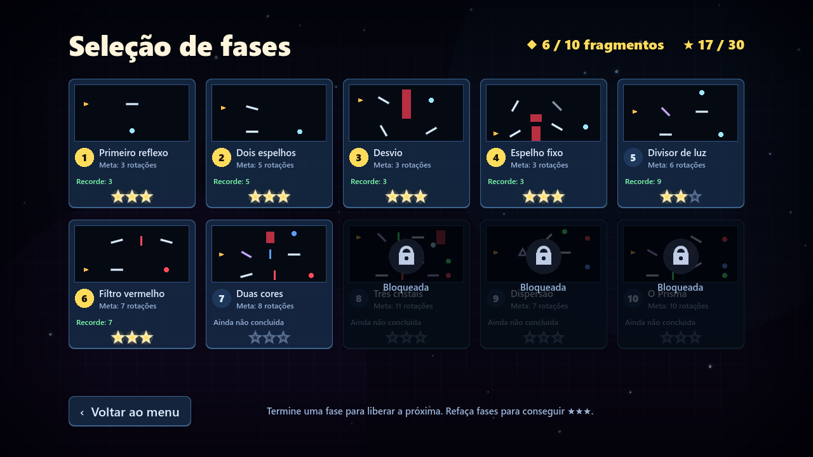

# GDD — PRISMA: O lugar onde a luz quebrou

**Game Design Document** · versão do jogo **3.0.0** · versão em PDF: [GDD_PRISMA.pdf](GDD_PRISMA.pdf)

Equipe: Eduardo Macedo, Felipe dos Anjos, Felipe Schwabe, Vinicius Mesquita
PAC Extensionista III · Engenharia de Software · Católica de Santa Catarina · Prof. Diego Sauter Possamai

## Sumário

1. [Visão geral](#1-visão-geral)
2. [Conceito e pilares de design](#2-conceito-e-pilares-de-design)
3. [Narrativa](#3-narrativa)
4. [Core loop](#4-core-loop)
5. [Mecânicas e regras da luz](#5-mecânicas-e-regras-da-luz)
6. [Controles](#6-controles)
7. [Progressão e recompensas](#7-progressão-e-recompensas)
8. [Level design](#8-level-design)
9. [Sistema de dicas (Echo)](#9-sistema-de-dicas-echo)
10. [Interface e telas](#10-interface-e-telas)
11. [Direção de arte](#11-direção-de-arte)
12. [Áudio](#12-áudio)
13. [Acessibilidade](#13-acessibilidade)
14. [Arquitetura técnica](#14-arquitetura-técnica)
15. [Escopo futuro](#15-escopo-futuro)

---

## 1. Visão geral

| | |
| --- | --- |
| **Título** | PRISMA — O lugar onde a luz quebrou |
| **Gênero** | Puzzle 2D de lógica espacial e óptica (jogo sério) |
| **Plataforma** | PC (Windows). O motor permite exportar para Linux, macOS e Web. |
| **Motor** | Godot Engine 4.6 (GDScript), renderizador *Compatibility* (OpenGL 3.3) |
| **Público-alvo** | A partir de 10 anos; estudantes do ensino fundamental e médio e jogadores de puzzles curtos |
| **Classificação** | Livre |
| **Duração** | 20 a 40 minutos para as 10 fases; mais tempo para conseguir as 30 estrelas |
| **Modo** | Um jogador, sem limite de tempo, com progresso salvo automaticamente |

## 2. Conceito e pilares de design

**High concept:** guie um raio de luz por espelhos, divisores, filtros e prismas para reacender os
cristais de cada sala e restaurar o Prisma de Luz, um fragmento por vez.

| Pilar | O que significa no jogo |
| --- | --- |
| **Clareza** | Todo giro tem retorno imediato: o feixe é recalculado a cada quadro, os pontos de reflexão soltam faíscas e o cristal acende com som e partículas. |
| **Uma ideia por vez** | Cada fase apresenta um único elemento novo, e a seguinte o combina com o que já foi aprendido. |
| **Planejamento** | As estrelas recompensam soluções com poucas rotações, o que incentiva observar antes de girar. |
| **Acessível para todos** | Tutorial visual, dicas em dois níveis, cores com forma, teclado, mouse e controle. |

## 3. Narrativa

O laboratório de luz era iluminado pelo **Prisma de Luz**, que se partiu em dez fragmentos. Cada
fragmento ficou preso em uma sala, guardado por cristais apagados. O jogador é guiado por **Echo**,
um pequeno assistente luminoso que apresenta cada mecânica e oferece dicas.

A cada sala concluída um fragmento é recuperado e aparece aceso, com uma cor do espectro, no prisma
do menu principal. Ao final da fase 10 o prisma é restaurado e a tela final celebra a conquista.
A narrativa é leve e dá sentido à progressão sem interromper os puzzles.

## 4. Core loop

```
Observar a sala → Selecionar um espelho → Girar (15°) → Ver o novo caminho da luz
       ↑                                                        │
       │                                                        ▼
Próxima fase ← Fragmento + estrelas ← Todos os cristais acesos? ┘ (não: continuar ajustando)
```

Uma rodada dura de 15 segundos a 3 minutos. O *desfazer* (`Z`) e o *reiniciar* (`R`) tiram o medo
de errar e incentivam a experimentação.

## 5. Mecânicas e regras da luz

| Elemento | Comportamento |
| --- | --- |
| **Emissor** | Origem do raio de luz branca, com direção fixa em cada fase. |
| **Espelho** | Reflete a luz (incidência = reflexão), pelos dois lados. Gira em passos de 15°. |
| **Espelho travado** | Reflete, mas não gira (cadeado). Ao tentar girá-lo, ele treme e toca um som grave. |
| **Divisor (roxo)** | Parte da luz atravessa reta e parte é refletida. Pode ser fixo ou girável. |
| **Filtro de cor** | A luz branca sai com a cor do filtro; luz da mesma cor passa; luz de outra cor é bloqueada. |
| **Prisma** | A luz branca sai em três raios: vermelho (−30°), verde (reto) e azul (+30°) em relação à entrada. Luz colorida atravessa reta. |
| **Bloco absorvedor** | Interrompe qualquer raio. |
| **Cristal** | Acende enquanto recebe luz. Com anel colorido, só aceita a cor indicada (▲ vermelho, ● verde, ■ azul). |
| **Paredes da sala** | Interrompem o raio, que nunca sai da área jogável. |

**Regras de vitória**

- A fase é vencida quando **todos os cristais estão acesos ao mesmo tempo** e os espelhos terminaram de girar.
- O estado dos cristais só muda com os espelhos parados, o que evita vitórias acidentais no meio de um giro.
- Como os espelhos giram em múltiplos de 15°, os raios seguem direções múltiplas de 30°, e as soluções ficam "limpas" e previsíveis.
- **Não há derrota**: sem limite de tempo ou de tentativas. O desafio é resolver com poucas rotações.

## 6. Controles

| Ação | Teclado e mouse | Controle |
| --- | --- | --- |
| Selecionar espelho | Clique, `1`–`9`, `Tab` / `Shift+Tab` | LB / RB |
| Girar | Arrastar a ponta, `Q`/`E`, `A`/`D`, ←/→, roda do mouse, clicar de novo (horário), clique direito (anti-horário) | Direcional ◀ ▶, A |
| Desfazer | `Z` | B |
| Dica | `H` (duas vezes mostra o ângulo) | Y |
| Reiniciar | `R` | X |
| Pausa | `Esc` ou `P` | Start |
| Próxima fase | `N`, `Enter`, `Espaço` | A |
| Música | `M` | Select |
| Tela cheia | `F11` ou `Alt+Enter` | — |

Os menus podem ser navegados pelo mouse, pelas setas do teclado ou pelo controle. O destaque de foco
só aparece quando o jogador usa teclado ou controle.

## 7. Progressão e recompensas

- **Desbloqueio linear:** terminar uma fase libera a próxima; dá para rejogar qualquer fase liberada.
- **Estrelas (até 3 por fase, 30 no total):** ★★★ se as rotações ≤ meta; ★★ até o dobro; ★ ao concluir.
- **Meta:** o menor número de rotações possível em cada fase, calculado pelo simulador e conferido pelos testes.
- **Fragmentos:** a primeira conclusão de cada fase recupera um fragmento ("Fragmento 3 de 10 recuperado!"), que acende no prisma do menu.
- **Recordes:** o melhor número de rotações aparece na seleção de fases; bater o recorde mostra "Novo recorde pessoal!".
- **Tempo:** mostrado no painel de vitória (informativo, não pontua).

## 8. Level design

Cada fase apresenta um conceito novo, e a seguinte o combina com os anteriores. Todas são validadas
automaticamente: existe solução, a fase não começa resolvida e a meta é o mínimo de rotações
(`tools/level_simulator` e `tests/run_tests.gd`).

| # | Fase | O que ensina / novidade | Elementos | Meta |
| --- | --- | --- | --- | --- |
| 1 | Primeiro reflexo | Espelho a 45° vira o raio de horizontal para vertical. Tutorial com seta animada. | 1 espelho | 3 |
| 2 | Dois espelhos | Encadear reflexões; trocar de espelho; desfazer | 2 espelhos | 5 |
| 3 | Desvio | Bloqueios absorvem a luz; é preciso contornar | 3 espelhos, 1 bloco | 3 |
| 4 | Espelho fixo | Usar a seu favor um espelho que não gira | 4 espelhos (1 travado), 2 blocos | 3 |
| 5 | Divisor de luz | Um raio vira dois; dois cristais ao mesmo tempo | 1 divisor, 2 espelhos | 6 |
| 6 | Filtro vermelho | Cristal que exige cor; a luz branca direta não serve | 3 espelhos, 1 filtro | 7 |
| 7 | Duas cores | Dividir e colorir cada metade; filtro bloqueia cor errada | 1 divisor, 2 espelhos, 2 filtros | 8 |
| 8 | Três cristais | Dividir, colorir e dividir de novo | 2 divisores, 3 espelhos, 2 filtros | 11 |
| 9 | Dispersão | O prisma separa a luz em vermelho, verde e azul | 1 prisma, 3 espelhos | 7 |
| 10 | O Prisma | O verde do prisma está bloqueado e precisa vir do divisor + filtro | prisma, divisor, filtro, 3 espelhos, bloco | 10 |


## 9. Sistema de dicas (Echo)

- **Apresentação:** ao entrar em cada fase, Echo explica a mecânica nova em uma frase. O aviso aparece no canto com menos peças e fica transparente quando o mouse passa por cima.
- **Dica de 1º nível (`H`):** pista em texto, sem entregar a solução.
- **Dica de 2º nível (`H` de novo):** um contorno verde pontilhado mostra o ângulo certo de **um** espelho ainda errado. O contorno some ao acertar, e cada novo pedido revela mais um espelho.
- **Ajuda espontânea:** depois de 45 s sem resolver e sem pedir dica, Echo lembra que a tecla `H` existe.


## 10. Interface e telas

| Tela | Conteúdo |
| --- | --- |
| Menu principal | Jogar/Continuar, Seleção de fases, Como jogar, Opções, Créditos, Sair; prisma animado com os fragmentos recuperados; total de estrelas |
| Seleção de fases | 10 cartões com miniatura da sala, meta, recorde, estrelas e cadeado |
| HUD da fase | Nome, objetivo, rotações (com cor em relação à meta), cristais acesos, botões Dica/Reiniciar/Pausa; linha de controles que muda quando o controle é usado |
| Vitória | Título de fragmento, estrelas animadas, rotações, meta, tempo, recorde; Fases / Jogar de novo / Próxima fase |
| Pausa | Continuar, Reiniciar, Música, Seleção de fases, Menu principal |
| Tela final | Prisma restaurado com os 10 fragmentos, confete, total de estrelas |



## 11. Direção de arte

Estilo **minimalista, geométrico e luminoso**: um laboratório escuro em que a luz é a protagonista.
Todos os gráficos são vetoriais e desenhados por código (`_draw()`), sem imagens. Isso garante
nitidez em qualquer resolução e permite animar tudo.

| Uso | Cor | Observação |
| --- | --- | --- |
| Fundo / sala | `#03050A` / `#060A13` | Gradiente escuro, grade azulada, poeira de luz e vinheta |
| Luz branca | `#FFED9E` | Tom quente para diferenciar do branco da interface |
| Vermelho / verde / azul | `#FF4D5C` / `#57FF80` / `#5C9EFF` | Sempre acompanhados de forma: ▲ ● ■ |
| Destaque / seleção | `#FFDB5C` | Seleção de espelho, estrelas, foco |
| Painéis | `#090E1A` + borda `#6BB8FF` | Cantos arredondados e sombra suave |

O feixe é desenhado em camadas com *blend* aditivo, o que cria o brilho, e tem pulsos viajando na
direção da luz. Na vitória há *flash*, um leve tremor de câmera e partículas.

## 12. Áudio

- **Música:** trilha do menu (`menu_loop.mp3`) e das fases (`gameplay_music.mp3`), em loop, com transição suave. Não reinicia ao trocar de fase.
- **Efeitos (11, sintetizados por código):** passar o mouse, clique, selecionar, girar, desfazer, espelho travado, cristal aceso, cristal apagado, dica, vitória e fanfarra final.
- Volumes de música e efeitos independentes e salvos; `M` liga e desliga a música.

## 13. Acessibilidade

- **Daltonismo:** cada cor tem uma forma (▲ ● ■) nos cristais, filtros e pulsos do feixe.
- **Vários métodos de entrada:** teclado, mouse (clique, arrastar, roda) e controle, com navegação completa dos menus.
- **Sem pressão de tempo:** o tempo é só informativo, o jogo pausa sozinho ao perder o foco da janela, e o desfazer é ilimitado.
- **Ajuda em camadas:** tutorial visual, dicas em dois níveis e lembrete do Echo.
- Interface que escala para qualquer resolução e modo de tela cheia.

## 14. Arquitetura técnica

- **Fases guiadas por dados:** `scripts/levels.gd` descreve cada fase (gerado a partir de `tools/level_simulator/levels.json`). A cena `scenes/main.tscn` cria os objetos a partir desses dados ([ADR 001](adr/001-fases-como-dados-em-script.md)).
- **Regras puras e testáveis:** `scripts/geometria.gd` (rotação, reflexão, interseções, estrelas) e `scripts/feixe.gd` (caminho da luz com fila de raios para divisores e prismas). O jogo e os testes usam o mesmo código ([ADR 005](adr/005-calculo-do-feixe-puro-e-testavel.md)).
- **Autoloads:** `GameState` (progresso e salvamento em `user://prisma_save.cfg`), `Sfx` (áudio) e `Transition` (transições).
- **Qualidade:** `tests/run_tests.gd` cobre as regras e as 10 fases; a CI roda os testes a cada push, e a CD publica a build Windows a cada tag de versão.

## 15. Escopo futuro

Ver a seção 8 do [README](../README.md#8-limitações-conhecidas-e-o-que-ainda-não-foi-implementado):
testes com jogadores externos, métricas por fase, mais fases e mecânicas, Echo contextual, versão Web,
acessibilidade ampliada e versão em inglês.
